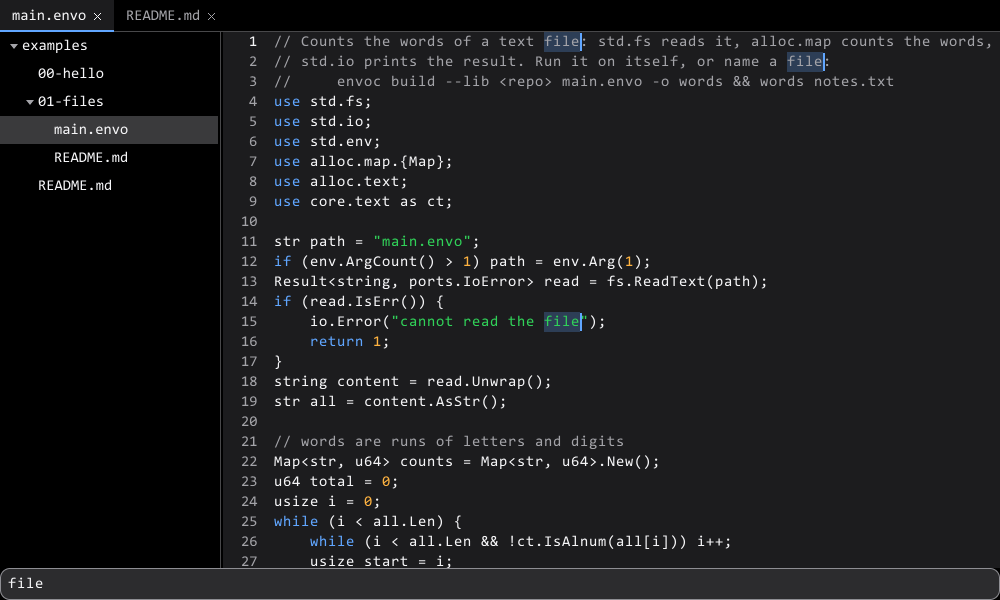
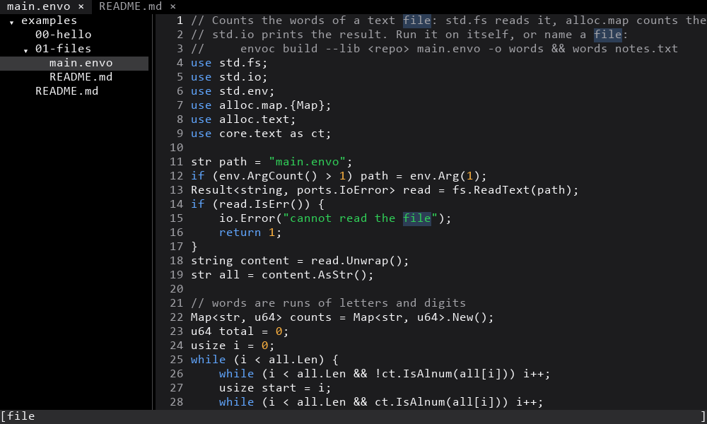

# EnvoScale

**Envo** is a programming language, and **EnvoScale** is everything around it in one
place: the compiler, the standard library and the `envo` tool. Command-line programs,
servers, desktop and terminal apps, websites, graphics and AI all use the same language
and the same library, with no third-party code anywhere.

```envo
print("Hello, World!");
```

```envo
use envo.crypto;
print(crypto.Sha256("Hello, World!").Hex().AsStr());
```

```envo
use envo.http;

http.Response Hello(in http.Request req) => http.Response.Text(200, "Hello, World!");

http.Router app = http.Router.New();
app.Get("/", new http.Handler { Fn = Hello });
http.Serve(ref app, "127.0.0.1", 8080);
```

The editor parts of the UI library, drawn by Envo itself, in a window and in a terminal:

 

> **Early and experimental.** It works, it is tested on every commit, and things still
> change. [docs/status.md](docs/status.md) says what is done.

## Try it

You need Git Bash or a Linux shell (or PowerShell on Windows), and nothing else.

```bash
git clone https://github.com/envoscale/EnvoScale
cd EnvoScale
./build.sh build
build/envo/envo run examples/00-hello/main.envo
```

On Windows without Git Bash, use `.\build.ps1 build` and `build\envo\envo.exe`.

`build` downloads a small starting compiler (see [below](#where-the-compiler-comes-from)),
uses it to build the compiler from this repository, and builds `envo` with that. It takes
about a minute.

## The `envo` tool

| Command | What it does |
|---|---|
| `envo run app.envo` | Runs a program as a script, sandboxed: `--allow net,fs:./data` to give it more |
| `envo build app.envo -o app` | Builds a native executable for Windows, Linux or macOS, x86-64 or AArch64, or WebAssembly |
| `envo new hello` | Starts a project |
| `envo test` | Runs the tests in `tests/` folders |
| `envo fmt` | Formats code; there is one layout |
| `envo lsp` | The language server, for any editor; there is a [VS Code extension](adapters/editors/vscode) |
| `envo dbg`, `envo prof`, `envo fuzz` | Debugger, profiler and fuzzer |
| `envo repl` | An interactive prompt |
| `envo explain E0203` | Explains an error |

## The standard library

| | |
|---|---|
| `std` | Files, paths, processes, environment, time, randomness, the clipboard |
| `envo.http`, `envo.tls`, `envo.crypto` | HTTP/1.1 client and server, a TLS 1.3 client, SHA-2, ChaCha20-Poly1305, AES-GCM, X25519, Ed25519 |
| `envo.json`, `envo.eon`, `envo.markdown` | Data formats |
| `envo.ui`, `envo.edit`, `envo.lumen` | A UI toolkit with editors, trees, tabs and a command palette, one look in a window or a terminal |
| `envo.gfx`, `envo.font`, `envo.gpu`, `envo.render3d` | 2D drawing, TrueType fonts, the GPU, 3D |
| `envo.term`, `envo.cli` | Terminal apps and command-line parsing |
| `envo.web` | Websites; [this project's site](website) is an Envo program |
| `envo.ai` | Tensors, training, tokenizers, and running Llama-family models locally |

Operating system and driver code lives only in [`adapters/`](adapters); the library
itself never touches the OS ([how that works](docs/principles.md#ports-and-adapters)).

## Where the compiler comes from

The compiler is written in Envo and compiles itself. To build it you need a compiler to
start with: `build.sh` downloads one from
[EnvoScaleAsm](https://github.com/envoscale/EnvoScaleAsm), which builds it from a few
kilobytes of assembly you can read, and publishes it only when Linux and Windows built the
same bytes. The compiler then rebuilds itself from this repository's sources, so what you
get depends on these sources, not on the downloaded one.

## Repository

| Folder | |
|---|---|
| [`compiler/`](compiler) | The compiler, `envoc` |
| [`lib/`](lib) | The standard library |
| [`adapters/`](adapters) | Everything platform-specific: Windows, Linux, macOS, the browser, Direct3D, editors |
| [`runtime/`](runtime) | The interpreter behind `envo run` |
| [`tools/`](tools) | The `envo` tool |
| [`tests/`](tests) | The test suites |
| [`examples/`](examples) | Small programs |
| [`website/`](website) | The website, written in Envo |
| [`docs/`](docs) | The language specification and how everything is built |

## Contributing

See [CONTRIBUTING.md](CONTRIBUTING.md). `./build.sh test` runs every test.

## License

Free for personal, educational and other noncommercial use under the PolyForm
Noncommercial License 1.0.0; companies need a commercial license.
[docs/legal/licensing.md](docs/legal/licensing.md) explains it, and [LICENSE](LICENSE)
has the terms.
